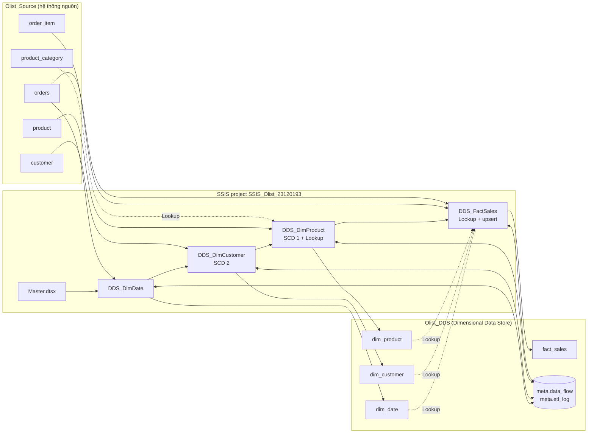
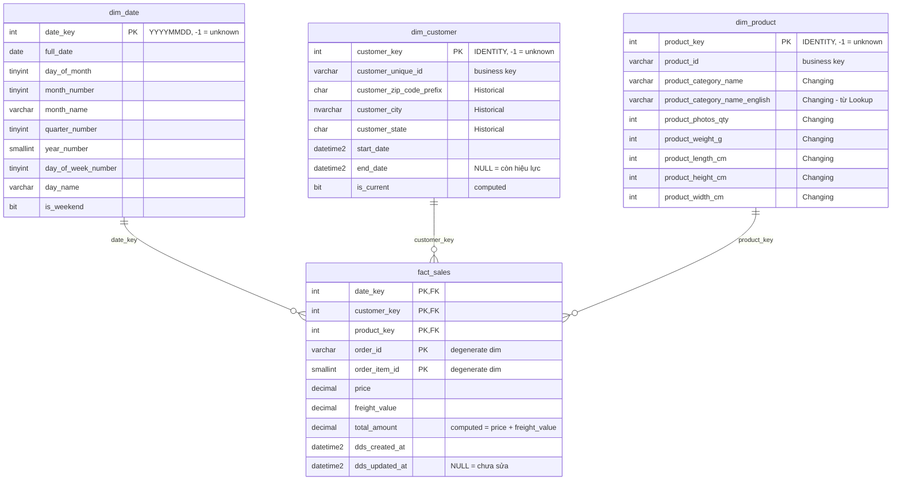

# Bài tập cá nhân SSIS – Nạp DDS theo incremental extract + SCD

- **Sinh viên:** Trần Kim Yến – MSSV **23120193**
- **Môn:** Business Intelligence (CSC12107) – HCMUS
- **Đề bài:** Tạo DDS đơn giản dựa vào mini project; build SSIS package nạp dữ liệu từ source vào DDS theo phương pháp
  *incremental extract* (3 chiều: khách hàng, sản phẩm, thời gian + fact), áp dụng SCD, kiểm tra upsert, quản lý key trong DDS.
  Quay video thực thi và show dữ liệu source / DDS trước và sau khi nạp.

Mini project nhóm dùng Mage + dbt + PostgreSQL trên dataset **Olist Brazilian E-Commerce**. Bài cá nhân này làm lại phần
**Source → DDS** bằng **SQL Server + SSIS**, theo đúng cách giảng viên dạy trong tài liệu *SSIS – SCD*:

```
Set CET → Get LSET/CET (bảng metadata data_flow) → Data Flow: OLE DB Source (created/updated trong [LSET, CET))
        → Lookup → Slowly Changing Dimension → Set LSET = CET khi thành công
```

---

## 1. Kết quả tóm tắt

| Nội dung | Kết quả (chạy thật bằng `DTExec` trên SQL Server 2025) |
|---|---|
| Nạp lần đầu (`Master.dtsx`) | `dim_customer` 5.153 + 1 · `dim_product` 3.068 + 1 · `dim_date` 86 + 1 · `fact_sales` 5.906; tổng price/freight DDS = nguồn (741.960,19 / 113.557,51) |
| Chạy lại ngay | 0 dòng được lấy ra / thêm / sửa ở mọi package; surrogate key không đổi |
| Sau khi nguồn thay đổi | chỉ lấy đúng phần thay đổi: `dim_customer` 2.356 dòng (2.353 mới + 3 đổi địa chỉ), `dim_product` 1.122 (1.119 mới + 3 đổi thuộc tính), `fact_sales` 2.687 (2.684 mới + 3 sửa giá) |
| SCD type 2 | 3 khách đổi địa chỉ → mỗi khách có 2 dòng (cũ có `end_date`, mới còn hiệu lực); đơn quý 1 giữ key cũ, đơn tháng 4 dùng key mới |
| SCD type 1 | 3 sản phẩm bị ghi đè tại chỗ, `product_key` giữ nguyên, số dòng không tăng |
| Upsert fact | 3 dòng cũ được UPDATE đúng (giá mới), số dòng fact chỉ tăng 2.684 |
| Chạy lại lần nữa | 0 / 0 / 0 (idempotent) |
| Lỗi giữa chừng | package ghi `FAILED` vào `meta.etl_log`, LSET không tiến; sửa lỗi chạy lại thì không mất dữ liệu |

Chi tiết số liệu ở mục [9](#9-kết-quả-kiểm-thử-chạy-thật).

---

## 2. Kiến trúc tổng quát



Cứ mỗi package nạp một bảng DDS, và **luôn theo cùng một khuôn**:

```
Set CET ─► Get LSET CET ─► [ Data Flow: Source (created/updated ∈ [LSET, CET)) ─► … ─► Destination ] ─► Set LSET to CET ─► Write ETL log
                                                       (nếu lỗi bất kỳ: OnError ─► ghi FAILED vào meta.etl_log, LSET KHÔNG đổi)
```

Thứ tự trong `Master.dtsx`: **dim_date → dim_customer → dim_product → fact_sales** (chiều trước, fact sau để fact tra được khóa).

---

## 3. Thiết kế DDS (star schema)



| Thành phần | Quyết định thiết kế |
|---|---|
| **Quy trình nghiệp vụ** | Bán hàng (đơn hàng của sàn Olist) |
| **Grain của `fact_sales`** | **1 dòng = 1 dòng hàng (`order_item`) của 1 đơn hàng**. Khóa chính = **khóa của các chiều** (`date_key`, `customer_key`, `product_key`) **+ degenerate dimension** (`order_id`, `order_item_id`). Chỉ 3 khóa chiều thì chưa duy nhất: ở đợt 1 có 393 nhóm trùng (cùng khách mua cùng sản phẩm cùng ngày – phần lớn là 1 đơn mua nhiều đơn vị cùng sản phẩm); thêm `order_id` còn 390 nhóm; thêm cả `order_item_id` thì hết trùng (kiểm bằng khối B4b của `05_demo_queries.sql`) |
| **Measures** | `price`, `freight_value`, `total_amount` (= price + freight, là *computed column persisted* nên luôn khớp 2 cột gốc) |
| **Chiều** | `dim_date` (khóa YYYYMMDD), `dim_customer` (**SCD 2**), `dim_product` (**SCD 1**) |
| **Surrogate key (SK)** | `customer_key`, `product_key` là `INT IDENTITY` do **DDS tự cấp**, không phụ thuộc nguồn. `dim_date.date_key` = YYYYMMDD tính từ ngày |
| **Business key (BK)** | `customer_unique_id`, `product_id` – giữ lại để so khớp với nguồn |
| **Unknown member** | Mỗi chiều có dòng `-1` ("Không xác định" / `Unknown`). Dòng fact tra không ra chiều → gán `-1` thay vì mất dòng |
| **Ràng buộc** | PK, FK (fact → 3 chiều), `UNIQUE` trên business key của `dim_product`, *filtered unique index* "mỗi khách chỉ có 1 phiên bản hiện hành" ở `dim_customer` |
| **Metadata** (schema `meta`) | `meta.data_flow(name, status, LSET, CET)` + `meta.etl_log` (nhật ký từng lần chạy) |

Script tạo: [`sql/03_create_dds.sql`](sql/03_create_dds.sql).

---

## 4. Incremental extract (LSET / CET)

Mọi bảng nguồn có 2 cột `created_at` (tự gán khi INSERT) và `updated_at` (`NULL` = chưa sửa lần nào).

`meta.data_flow` có **1 dòng cho mỗi luồng nạp** (`dim_date`, `dim_customer`, `dim_product`, `fact_sales`):

| Cột | Ý nghĩa |
|---|---|
| `LSET` | *Last Successful Extraction Time* – mốc trích xuất thành công gần nhất (ban đầu `1900-01-01`) |
| `CET` | *Current Extraction Time* – mốc của lần chạy hiện tại |
| `status` | `1` = đang chạy / chưa xong, `0` = đã xong |

Một lần chạy package diễn ra như sau:

1. **Set CET** – `UPDATE meta.data_flow SET CET = SYSDATETIME(), status = 1 WHERE name = '…'`
2. **Get LSET CET** – đọc LSET, CET vào 2 biến `User::LSET`, `User::CET` (kiểu chuỗi `yyyy-mm-dd hh:mi:ss.mmm` để không mất phần mili-giây)
3. **Data Flow** – chỉ lấy dòng thay đổi trong **[LSET, CET)**:
   ```sql
   WHERE (created_at >= ? AND created_at < ?) OR (updated_at >= ? AND updated_at < ?)   -- 4 dấu ? = LSET, CET, LSET, CET
   ```
4. **Set LSET to CET** – chỉ chạy khi data flow **thành công** (precedence constraint *Success*): `LSET = CET, status = 0`
5. **Write ETL log** – ghi số dòng lấy ra / thêm / sửa / không đổi vào `meta.etl_log`

Nếu data flow lỗi thì bước 4 không chạy ⇒ LSET đứng yên ⇒ lần sau lấy lại đúng phần dữ liệu chưa nạp (**không mất dữ liệu**).
Vì khoảng là nửa mở `[LSET, CET)` nên dòng nằm đúng mốc CET sẽ thuộc lần chạy kế tiếp, không bị lấy hai lần.

---

## 5. Các package trong project `SSIS_Olist_23120193`

Project dùng *Project Deployment Model*, `TargetServerVersion = SQL Server 2025`, `ProtectionLevel = DontSaveSensitive`
(không lưu mật khẩu; kết nối dùng Windows authentication). Hai **project connection manager**: `Olist_Source`, `Olist_DDS`.

**Biến dùng chung** của 4 package nạp dữ liệu: `LSET`, `CET` (chuỗi) · `RowsExtracted`, `RowsNew`, `RowsHistorical`, `RowsChanged`,
`RowsUnchanged` (số dòng, do các *Row Count* ghi vào) · `RowsInserted` = `RowsNew + RowsHistorical`,
`RowsUpdated` = `RowsHistorical + RowsChanged` (biến dạng expression) · `StartTimeText` (giờ bắt đầu dạng chuỗi).

### 5.1 `DDS_DimDate.dtsx` – chiều thời gian

| Control flow | |
|---|---|
| `Set CET` → `Get LSET CET` → `Load dim_date` (Data Flow) → `Set LSET to CET` → `Write ETL log` | |

Data flow `Load dim_date`:
`Source dates of new orders` (OLE DB Source: sinh dãy ngày từ ngày mua nhỏ nhất đến lớn nhất của các đơn có `created_at`/`updated_at ∈ [LSET, CET)`
bằng CTE đệ quy) → `Count extracted rows` → `Lookup dim_date` →
&nbsp;&nbsp;• *Match* → `Count unchanged rows` (ngày đã có) ·
&nbsp;&nbsp;• *No Match* → `Count new rows` → `Insert rows to dim_date`.

### 5.2 `DDS_DimCustomer.dtsx` – **SCD type 2** (đúng mẫu trong tài liệu)

Data flow `Load dim_customer`:

```
Source customer ─► Count extracted rows ─► Slowly Changing Dimension ─┬─ Unchanged Output ───────────────► Count unchanged rows
                                                                      ├─ New Output ─► Count new rows ──────────────┐
                                                                      └─ Historical Attribute Inserts Output        │
                                                                           ─► Set old row's expiry date             │
                                                                           ─► Expire the old row (OLE DB Command)   │
                                                                           ─► Count historical rows ────────────────┤
                                                                                                                    ▼
                        Insert rows to dim_customer ◄─ Set new row's effective date ◄─────────────────────── Union All
```

- **Source customer**: `SELECT customer_unique_id, customer_zip_code_prefix, customer_city, customer_state FROM dbo.customer WHERE (created_at >= ? AND created_at < ?) OR (updated_at >= ? AND updated_at < ?)`
- **Slowly Changing Dimension** (bảng đích `dbo.dim_customer`, dùng *start/end date*):

  | Cột | Kiểu thay đổi |
  |---|---|
  | `customer_unique_id` | **Business key** |
  | `customer_zip_code_prefix`, `customer_city`, `customer_state` | **Historical attribute** (đổi ⇒ thêm dòng mới, đóng dòng cũ) |

  `CurrentRowWhere = [start_date] IS NOT NULL AND [end_date] IS NULL` (dòng hiện hành là dòng chưa có `end_date`).
  Không có Fixed attribute, không bật Inferred member.
- **Set old row's expiry date** (Derived Column): `end_date = (DT_DBTIMESTAMP2,3)@[System::StartTime]`
- **Expire the old row** (OLE DB Command): `UPDATE dbo.dim_customer SET end_date = ? WHERE customer_unique_id = ? AND end_date IS NULL`
- **Union All**: hợp *New Output* và nhánh Historical (đã đóng dòng cũ) để cùng chèn dòng mới
- **Set new row's effective date** (Derived Column): `start_date = (DT_DBTIMESTAMP2,3)@[System::StartTime]`, `end_date = NULL`
- **Insert rows to dim_customer** (OLE DB Destination, *Table or view* – chèn từng dòng để không khóa bảng trong lúc OLE DB Command đang UPDATE cùng bảng)

### 5.3 `DDS_DimProduct.dtsx` – **SCD type 1** + Lookup

Data flow `Load dim_product`:

```
Source product ─► Count extracted rows ─► Lookup category English ─┬─ Match ───────────────────────────────┐
                                                                   └─ No Match ─► Set Unknown category ────┤
                                                                                                           ▼
   Slowly Changing Dimension ◄──────────────────────────────────────────────────────────────────── Union All
        ├─ Unchanged Output ─► Count unchanged rows
        ├─ New Output ─► Count new rows ─► Insert rows to dim_product
        └─ Changing Attribute Updates Output ─► Count changed rows ─► Update changed attributes (OLE DB Command)
```

- **Lookup category English** (khử chuẩn hóa, full cache, kết nối `Olist_Source`):
  `SELECT product_category_name, product_category_name_english FROM dbo.product_category`, nối theo `product_category_name`,
  lấy thêm cột `product_category_name_english`. **Không khớp** (category `NULL` hoặc chưa có bản dịch như `pc_gamer`) → nhánh *No Match* →
  `Set Unknown category` gán `'Unknown'`.
- **Slowly Changing Dimension**: `product_id` = **Business key**; `product_category_name`, `product_category_name_english`,
  `product_photos_qty`, `product_weight_g`, `product_length_cm`, `product_height_cm`, `product_width_cm` = **Changing attribute**
  (SCD type 1: ghi đè, không giữ lịch sử).
- **Update changed attributes** (OLE DB Command): `UPDATE dbo.dim_product SET … = ? , … WHERE product_id = ?` → `product_key` không đổi.

### 5.4 `DDS_FactSales.dtsx` – Lookup khóa + **upsert**

Data flow `Load fact_sales`:

```
Source order_item ─► Count extracted rows
  ─► Lookup date_key     ─ Match ─┐        ─► Lookup customer_key ─ Match ─┐        ─► Lookup product_key ─ Match ─┐
                         No Match ─► Set unknown date_key ─► Union All date_key    … tương tự cho customer_key, product_key (Union All …)
  ─► Lookup fact_sales (đã có dòng fact này chưa?)
        ├─ No Match ─► Count new rows ─► Insert rows to fact_sales                              (INSERT)
        └─ Match ─► Price or freight changed (Conditional Split)
                       ├─ Changed ─► Count updated rows ─► Update fact_sales (OLE DB Command)   (UPDATE)
                       └─ Unchanged Output ─► Count unchanged rows
```

- **Source order_item**: `order_item JOIN orders`, điều kiện incremental trên `created_at`/`updated_at` của **cả hai bảng** (8 tham số `?` = 4 × LSET/CET),
  tính sẵn `order_date_key = YYYYMMDD` của ngày mua.
- **Lookup date_key** (`SELECT date_key FROM dbo.dim_date`), **Lookup customer_key**
  (`SELECT customer_unique_id, customer_key FROM dbo.dim_customer WHERE is_current = 1` – lấy **phiên bản hiện hành** của khách),
  **Lookup product_key** (`SELECT product_id, product_key FROM dbo.dim_product`). Cả 3 đều cấu hình
  *Redirect rows to no match output*; nhánh không khớp gán khóa `-1` (**unknown member**) rồi `Union All` trở lại dòng chảy chính.
- **Lookup fact_sales**: `SELECT order_id, order_item_id, price AS dds_price, freight_value AS dds_freight FROM dbo.fact_sales` – tra theo `order_id`, `order_item_id` (định danh dòng hàng ở nguồn) chứ không theo cả khóa chính, vì khi khách đã có phiên bản SCD2 mới thì `customer_key` khác, tra theo cả khóa chính sẽ không khớp và chèn trùng
  nối theo (`order_id`, `order_item_id`) – **No Match** = dòng mới → INSERT; **Match** → so `price`/`freight_value` với `dds_price`/`dds_freight`
  bằng `Price or freight changed` (Conditional Split, điều kiện `price != dds_price || freight_value != dds_freight`).
- **Update fact_sales**: `UPDATE dbo.fact_sales SET price = ?, freight_value = ?, dds_updated_at = SYSDATETIME() WHERE order_id = ? AND order_item_id = ?`
  (chỉ sửa các thước đo, **không** đổi `customer_key` / `product_key` / `date_key`, nên lịch sử SCD2 không bị xáo).

### 5.5 `Master.dtsx`

4 *Execute Package Task* (tham chiếu package trong cùng project) nối tiếp bằng precedence constraint:
`Run DDS_DimDate` → `Run DDS_DimCustomer` → `Run DDS_DimProduct` → `Run DDS_FactSales` → `Write ETL log`. Có `OnError` ghi `FAILED`.

---

## 6. SCD – cách Slowly Changing Dimension component chia luồng

Với mỗi dòng nguồn, component so khớp **business key** với bảng đích rồi chia vào các output (đúng sơ đồ trong tài liệu *SCD*):

| Output | Điều kiện | Package dùng |
|---|---|---|
| **New Output** | business key chưa có trong dim | cả 2 → chèn dòng mới |
| **Unchanged Output** | có rồi, không cột nào đổi | chỉ đếm |
| **Historical Attribute Inserts Output** | đổi cột *Historical* | `dim_customer`: đóng dòng cũ (`end_date`) + chèn dòng mới (SCD2) |
| **Changing Attribute Updates Output** | đổi cột *Changing* | `dim_product`: `UPDATE` ghi đè (SCD1) |
| Fixed Attribute / Inferred Member | không dùng trong bài này | – |

---

## 7. Upsert và quản lý key

- **Upsert** = *update or insert*: dim dùng SCD component; fact dùng *Lookup + Conditional Split* (không có "MERGE" dựng sẵn trong data flow).
- **Surrogate key**: do `IDENTITY` của DDS cấp; không bao giờ thay đổi sau khi cấp (kiểm chứng bằng `CHECKSUM_AGG` trước / sau mỗi lần chạy lại).
  SCD1 giữ nguyên SK; SCD2 cấp SK mới cho phiên bản mới.
- **Fact trỏ đúng phiên bản của khách**: lúc nạp, fact tra `dim_customer` với `is_current = 1` ⇒ đơn nạp trước khi khách đổi địa chỉ giữ key cũ,
  đơn nạp sau trỏ key mới. Nhờ vậy báo cáo "doanh thu theo địa chỉ lúc mua" luôn đúng lịch sử.
- **Unknown member** `-1` ở cả 3 chiều; fact gán `-1` khi lookup không khớp (thay vì làm rớt dòng hoặc lỗi FK).
- **Business key** giữ lại ở dim, có ràng buộc `UNIQUE` / *filtered unique index* để không bao giờ trùng.

---

## 8. Cấu trúc thư mục

```
SSIS_23120193/
├── README.md                     # tài liệu này
├── SSIS_Olist_23120193/          # solution + project SSIS (mở file .slnx bằng Visual Studio)
│   ├── SSIS_Olist_23120193.slnx / .dtproj / .database / Project.params
│   ├── Olist_Source.conmgr, Olist_DDS.conmgr       # project connection managers (Windows authentication)
│   └── Master.dtsx, DDS_DimDate.dtsx, DDS_DimCustomer.dtsx, DDS_DimProduct.dtsx, DDS_FactSales.dtsx
├── sql/
│   ├── 01_create_source_db.sql       # tạo database nguồn Olist_Source + 5 bảng
│   ├── 02_seed_source_batch1.sql     # nạp đợt 1 vào nguồn (đơn quý 1/2017)
│   ├── 03_create_dds.sql             # SCRIPT TẠO DDS: Olist_DDS, dim, fact, meta, unknown member
│   ├── 04_source_changes_batch2.sql  # "ngày làm việc mới" ở nguồn: dữ liệu tháng 4 + các dòng bị sửa
│   ├── 05_demo_queries.sql           # truy vấn xem dữ liệu nguồn / DDS trước và sau khi nạp
│   ├── 99_reset_all.sql              # xóa Olist_Source + Olist_DDS
│   └── reset_and_prepare.cmd         # đưa môi trường về trạng thái sẵn sàng (99 → 01 → 02 → 03)
└── datasource/
    ├── README.md                     # nguồn Kaggle, cách lọc, số dòng
    ├── prepare_datasource.py         # đọc CSV Kaggle → sinh CSV + 02/04_*.sql
    ├── batch1_initial/*.csv          # dữ liệu đợt 1
    └── batch2_april/*.csv            # dữ liệu đợt 2
```

---

## 9. Kết quả kiểm thử (chạy thật)

Chạy bằng `DTExec` 64-bit trên SQL Server 2025 từ ispac do Visual Studio build, bắt đầu từ môi trường sạch.

| Lần | Thao tác | `dim_date` | `dim_customer` | `dim_product` | `fact_sales` | Thời gian `Master` |
|---|---|---|---|---|---|---|
| T1 | **Nạp lần đầu** | lấy 86 / thêm 86 | lấy 5.153 / thêm 5.153 | lấy 3.068 / thêm 3.068 | lấy 5.906 / thêm 5.906 | ≈ 12 s |
| T2 | Chạy lại ngay | 0 / 0 | 0 / 0 | 0 / 0 | 0 / 0 | ≈ 3,5 s |
| T3 | Chạy `04_…sql` rồi `Master` | lấy 30 / thêm 30 | lấy 2.356 / thêm 2.356 / **sửa 3** | lấy 1.122 / thêm 1.119 / **sửa 3** | lấy 2.687 / thêm 2.684 / **sửa 3** | ≈ 7 s |
| T4 | Chạy lại lần nữa | 0 / 0 | 0 / 0 | 0 / 0 | 0 / 0 | ≈ 3,5 s |

*(“sửa” ở `dim_customer` = số dòng cũ bị đóng `end_date` do SCD2.)*

Số dòng sau T3/T4: `dim_date` 117 · `dim_customer` 7.510 (= 5.153 + 2.353 + 3 + 1 unknown) · `dim_product` 4.188 (= 3.068 + 1.119 + 1 unknown) · `fact_sales` 8.590.

**Kiểm tra chéo sau T3 / T4** (`sql/05_demo_queries.sql`, khối [F]): không trùng khóa chính fact, không dòng fact mồ côi (FK), mỗi khách tối đa 1 phiên bản hiện hành,
tổng `price` và `freight_value` DDS = nguồn (1.101.870,43 / 166.060,02), không dòng fact nào dùng unknown member.

**Khóa trước / sau (T3):**

| Loại | Đối tượng | Trước | Sau |
|---|---|---|---|
| SCD2 | khách `c51a1ea9fa9851c70f89d1178c861150` | key **3992** (22775) | key 3992 hết hạn + key **7507** (22795) hiện hành |
| SCD2 | khách `d3f15df5924e63131bcdac6364b6a6fd` | key **4282** (franca) | key 4282 hết hạn + key **7508** (diadema) |
| SCD2 | khách `da5bbfd583efb762f6fda762f1aaf4a9` | key **4397** (maringa) | key 4397 hết hạn + key **7509** (londrina) |
| SCD1 | sản phẩm `0152f69b6cf919bcdaf117aa8c43e5a2` | key 18, 250 g | key **18**, 750 g |
| SCD1 | sản phẩm `0233dd6f06e23c705ab76dc3ab165837` | key 25, 20/16/16 cm | key **25**, 25/19/18 cm |
| SCD1 | sản phẩm `02ce467092b184e71d3967d29110adc1` | key 32, `moveis_escritorio` / office_furniture | key **32**, `utilidades_domesticas` / housewares |
| Upsert | `00042b26…` #1 | price 199,90 | **189,90** (`dds_updated_at` có giá trị) |
| Upsert | `00125cb6…` #1 | freight 25,51 | **30,51** |
| Upsert | `001dbc16…` #1 | price 69,90 / freight 18,00 | **62,91** / **20,50** |

Đơn của 3 khách SCD2: đơn quý 1 vẫn trỏ key cũ (3992 / 4282 / 4397), đơn tháng 4 trỏ key mới (7507 / 7508 / 7509).

**Kiểm thử lỗi giữa chừng (T5):**

- Đổi tên tạm bảng `dim_product` trong DDS → `Master` dừng ở `DDS_DimProduct` (lỗi *Opening a rowset for "[dbo].[dim_product]" failed*),
  `meta.etl_log` có dòng `FAILED`, `LSET` của `dim_product` không tiến, `DDS_FactSales` không chạy. Đổi tên lại rồi chạy tiếp → sản phẩm bị sửa trong lúc lỗi được nạp đúng (không mất dữ liệu).
- Lỗi lúc đang chạy data flow (thêm tạm `CHECK` constraint không cho `customer_state = 'ZZ'` rồi thêm 1 khách `ZZ` ở nguồn) →
  `DDS_DimCustomer` ghi `FAILED` kèm thông báo lỗi, `meta.data_flow.status` còn `1`, `LSET` không đổi. Bỏ constraint rồi chạy lại → khách đó được nạp (`lấy 1 / thêm 1`).
- Nhánh **Lookup không khớp**: thêm 1 dòng hàng tham chiếu sản phẩm chưa kịp có trong `dim_product` → dòng fact vẫn được nạp với `product_key = -1`.

*(Mọi thao tác lỗi ở trên đã được hoàn tác; các dữ liệu thử không có trong bài nộp.)*

---

## 10. Hướng dẫn chạy

### Yêu cầu

- **SQL Server 2025** (instance mặc định `localhost`, đăng nhập Windows) + **SSIS 2025**; công cụ `sqlcmd`.
- **Visual Studio 2026** có extension *SQL Server Integration Services Projects* (project đặt `TargetServerVersion = SQL Server 2025`).
- Provider **Microsoft OLE DB Driver 19 for SQL Server** (`MSOLEDBSQL19`). Chuỗi kết nối đã thêm `Use Encryption for Data=Optional`
  để không cần chứng chỉ TLS; nếu máy khác không có Driver 19, mở connection manager và đổi *Provider* sang `MSOLEDBSQL` hoặc `SQLNCLI`.
- Python 3 + pandas chỉ cần nếu muốn sinh lại datasource (không bắt buộc, file `.sql` đã có sẵn).

### Bước 1 – Dựng database nguồn và DDS

Cách nhanh (chạy 99 → 01 → 02 → 03):

```
sql\reset_and_prepare.cmd
```

hoặc mở lần lượt trong SSMS và chạy: `01_create_source_db.sql` → `02_seed_source_batch1.sql` → `03_create_dds.sql`.
Kết quả: `Olist_Source` có dữ liệu đợt 1, `Olist_DDS` trống (chỉ có unknown member), `meta.data_flow` có `LSET = 1900-01-01`.

> Nếu chạy script bằng SSMS: cần bật chế độ UTF-8 (file có BOM nên SSMS tự nhận). Nếu dùng `sqlcmd` hãy thêm `-I -f 65001`
> (script `03_create_dds.sql` cần `QUOTED_IDENTIFIER ON`).

### Bước 2 – Xem dữ liệu **trước** khi nạp

Mở `sql/05_demo_queries.sql`, chạy khối **[A]** (nguồn có dữ liệu, DDS trống, LSET = 1900).

### Bước 3 – Nạp lần đầu

Trong Visual Studio: mở `SSIS_Olist_23120193/SSIS_Olist_23120193.slnx` → chuột phải **`Master.dtsx` → Execute Package**.
(Có thể chạy riêng từng package `DDS_Dim*.dtsx`, `DDS_FactSales.dtsx` – nhớ chạy chiều trước fact.)

Hoặc bằng dòng lệnh:

```
cd SSIS_Olist_23120193
"C:\Program Files\Microsoft SQL Server\170\DTS\Binn\DTExec.exe" /Project bin\Development\SSIS_Olist_23120193.ispac /Package Master.dtsx
```

(ispac tạo ra khi Build project trong Visual Studio – menu *Build → Build Solution*.)

Xem lại khối **[B]** của `05_demo_queries.sql`: số dòng, surrogate key, unknown member, `data_flow` (LSET đã tiến), `etl_log`.

### Bước 4 – Tạo "dữ liệu thay đổi" ở nguồn

Chạy `sql/04_source_changes_batch2.sql` (chỉ chạy 1 lần), rồi khối **[C]**: nguồn có thêm dữ liệu tháng 4 + 3 khách đổi địa chỉ + 3 sản phẩm đổi thuộc tính + 3 dòng hàng sửa giá; **DDS chưa đổi**.

### Bước 5 – Nạp tăng dần (lần 2)

Chạy lại `Master.dtsx`. Xem khối **[D]**: khách SCD2 có 2 dòng, sản phẩm SCD1 ghi đè giữ key, fact upsert, `etl_log` lần 2 chỉ lấy phần thay đổi.

### Bước 6 – Chạy lần 3 (không có gì mới)

Chạy `Master.dtsx` lần nữa → khối **[E]** và **[F]**: mọi package `0 / 0 / 0 / 0`, DDS không đổi, các kiểm tra tổng quát đều bằng 0.

### Làm lại từ đầu

`sql\reset_and_prepare.cmd` (xóa và dựng lại cả hai database, đưa về trạng thái trước khi chạy package).

---

## 11. Lưu ý

- `System::StartTime` của SSIS chỉ chính xác đến **giây**, nên `start_date` / `end_date` của `dim_customer` có phần lẻ `.000`.
- `Slowly Changing Dimension` gọi một truy vấn đến bảng dim cho **từng dòng** nên chậm hơn kiểu MERGE/set-based; với vài nghìn dòng thì không đáng kể
  (đủ cho bài tập); với dữ liệu lớn nên chuyển sang staging + `MERGE`.
- `Insert rows to …` dùng chế độ *Table or view* (không fast load) vì SCD2 vừa UPDATE (OLE DB Command) vừa INSERT cùng một bảng trong một data flow.
- Fact chỉ nhận cập nhật cho `price` / `freight_value`; các thay đổi khác (vd đổi khách của đơn) không nằm trong phạm vi bài.
- Đừng mở lại *Slowly Changing Dimension Wizard* (bấm đúp vào component SCD rồi **Finish**) trong Visual Studio: wizard sẽ sinh thêm một luồng mới chồng lên luồng đã có sẵn. Muốn xem cấu hình thì dùng *Show Advanced Editor* (chuột phải → *Show Advanced Editor…*) hoặc chỉ đọc thuộc tính (`SqlCommand`, `CurrentRowWhere`, cột `ColumnType` của từng input column).
- Bài chưa xử lý **late-arriving dimension**: nếu dòng fact đến trước chiều của nó thì nhận khóa `-1` và không được sửa lại sau này.
